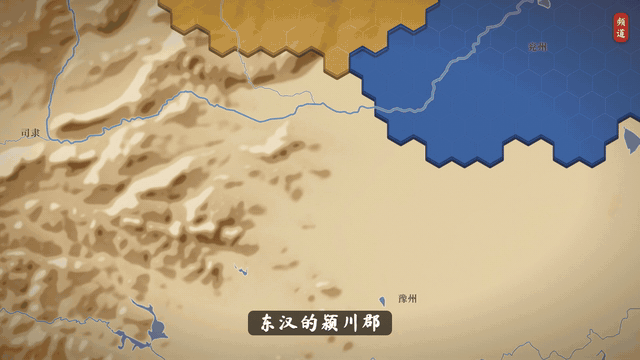
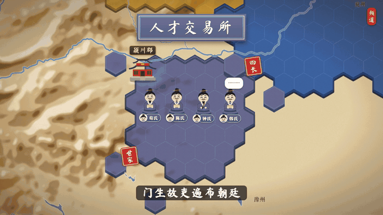
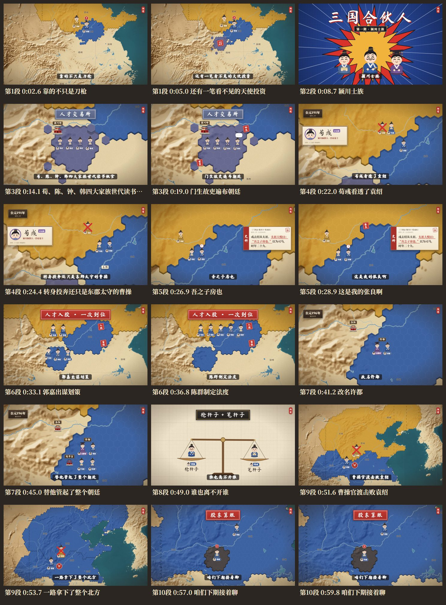

# 三国地图口播视频 · AI Skill

**一段三国口播文案 → 一条 60 秒“地图讲历史”的横屏视频。** 你只管写文案，AI 助手负责写分镜，工具包负责画面、配音、字幕、镜头和排版检查。

<p align="center">
  
  
</p>

- 复古浮雕地形图（真实高程数据渲染），**六边形格子拼成的势力版图**会一块块飞进来拼合、像潮水一样换色
- **Q 版棋子人物**：曹操、刘备、孙权、诸葛亮、关羽、张飞、袁绍、吕布……80 多个人物现成可用，会弹出、走路、打红叉、冒问号、变表情
- 城池、地名牌（会翻面改名）、红色印章、行军箭头、交战双刀、标题条、年份牌、人物卡、史料卡（红线划重点）
- 片头标题卡、天平对比、要点清单三种卡片
- AI 配音（免费，edge-tts）+ 毛笔字幕；**画面动作和口播逐字对齐**（说到“荀彧”荀彧就弹出来）
- 镜头自动对准每段的人物和标记，自动躲开标题条、卡片和字幕；人物挤在一起自动排队
- **给 AI 用的检查**：格式、地名、人物、字数、文案一字不改，外加一份文字版“画面报告”，看不了图片的 AI 也能自查排版

<p align="center"></p>

## 怎么用

### Claude Code / Codex（作为 Skill）

```bash
# Claude Code
git clone https://github.com/<你的用户名>/sanguo-map-video ~/.claude/skills/sanguo-map-video
# Codex
git clone https://github.com/<你的用户名>/sanguo-map-video ~/.codex/skills/sanguo-map-video
```

然后直接对 AI 说：

> 用三国地图视频 skill，把下面这段文案做成视频，频道名写“XX”：（贴文案）

第一次会自动在 `~/三国地图动画工具包` 建工作文件夹并安装（约 5~15 分钟），之后每条视频：AI 写分镜 → 检查 → 配音出检查图给你确认 → 出成片。

### DeepSeek Harness / Cursor / 其他 AI 助手（作为工具包）

1. 下载本仓库（Code → Download ZIP），解压到固定位置，例如 `D:\三国地图动画工具包` 或 `~/Documents/三国地图动画工具包`。
2. 双击 `1-首次安装`（Windows `.bat`，Mac `.command`），或者让 AI 按 `AGENTS.md` 安装。
3. 在 AI 助手里把这个文件夹选为工作区，打开 [`给DeepSeek的开场白.txt`](给DeepSeek的开场白.txt)，改好位置和频道名、贴上文案，整段发给 AI。

详细步骤见 [使用说明.md](使用说明.md)。

### 不用 AI

照着 [docs/积木说明.md](docs/积木说明.md) 自己写 `content/video.ts`，然后 `npm run preview` / `npm run make`（或双击 `2-出检查图`、`3-生成视频`）。

## 分镜长什么样

一条视频就是一个数据文件。每段一句口播、一个画面，`when` 写“说到哪个词时发生”：

```ts
{
  type: 'map',
  script: '公元191年，荀彧看透了袁绍，转身投奔还只是东郡太守的曹操。',
  items: [
    {type: 'figure', who: '袁绍', at: '邺', cross: '看透', moodAfter: {mood: 'worried', when: '看透'}},
    {type: 'figure', who: '荀彧', at: '邺', moveTo: {at: '东郡', when: '投奔', arrow: true}},
    {type: 'figure', who: '曹操', at: '东郡'},
  ],
  year: {year: '公元191年', era: '初平二年'},
  person: {who: '荀彧', zi: '字文若', line: '颍川颍阴人 · 首席谋士', when: '荀彧'},
}
```

完整示例：[三国合伙人·颍川士族](content/examples/三国合伙人-颍川士族.ts)（样片）、[官渡之战](content/examples/官渡之战-示例.ts)。
格式说明：[积木说明](docs/积木说明.md) · [地名表](docs/地名表.md)（约 150 个东汉三国地名）· [人物表](docs/人物表.md)

## 命令

| 命令 | 作用 |
| --- | --- |
| `npm run check` | 检查分镜（格式、地名、人物、when、字数、排版、文案一字不改） |
| `npm run preview` | 配音 + 时间轴 + 画面报告 + 检查图（不渲染整片，约 1~2 分钟） |
| `npm run make` | 出成片 `out/<标题>.mp4` + 字幕 `.srt`（60 秒约 3~5 分钟） |
| `npm run doctor` | 检查环境 |
| `npm run studio` | 浏览器里逐帧预览 |

环境：Windows 10/11 或 macOS 12+，Node.js 22.18+、Python 3.9+（安装脚本会自动下载便携版，不需要管理员权限），配音需要联网。渲染浏览器下载不了时会自动换国内镜像。

## 目录

```
SKILL.md                给 Claude Code / Codex 的 Skill 入口
AGENTS.md               给 AI 助手的完整流程和规则
content/video.ts        唯一需要写的文件（分镜数据）
content/examples/       示例
docs/                   积木说明、地名表、人物表
src/core/               纯逻辑：数据格式、地名表、人物表、配音时间对齐、自动镜头、排版检查、校验
src/scenes/ components/ map/   画面（Remotion + React）
public/map/             渲染好的浮雕底图和明暗贴图
scripts/                安装、一键生成、打包、更新、初始化工作文件夹
```

## 范围

- 地图范围是东汉十三州（经度 95~133，纬度 17~45.5），最适合讲三国 / 东汉。
- 横屏 1920×1080、30fps。一条 30~90 秒效果最好。

## 许可

代码和代码绘制的图形：MIT。字体：SIL OFL 1.1。地形数据：AWS Terrain Tiles（SRTM / GMTED2010 / ETOPO1），河流湖泊：Natural Earth。
**渲染引擎 Remotion 有自己的许可**：个人和 3 人以下公司免费，更大的公司商用需要购买许可。配音用的是微软 Edge 在线语音，商用前请自行确认条款。详见 [NOTICE.md](NOTICE.md)。
